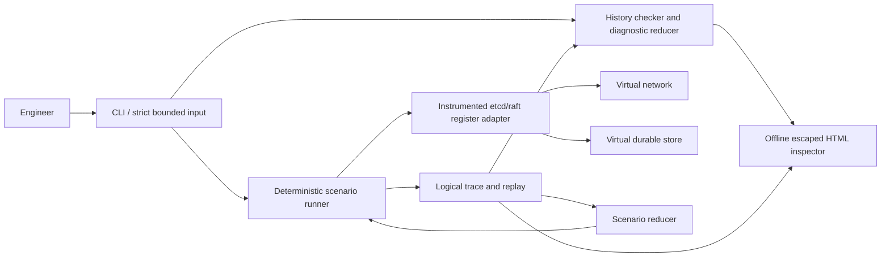
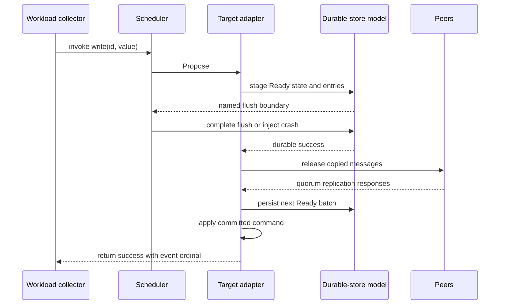
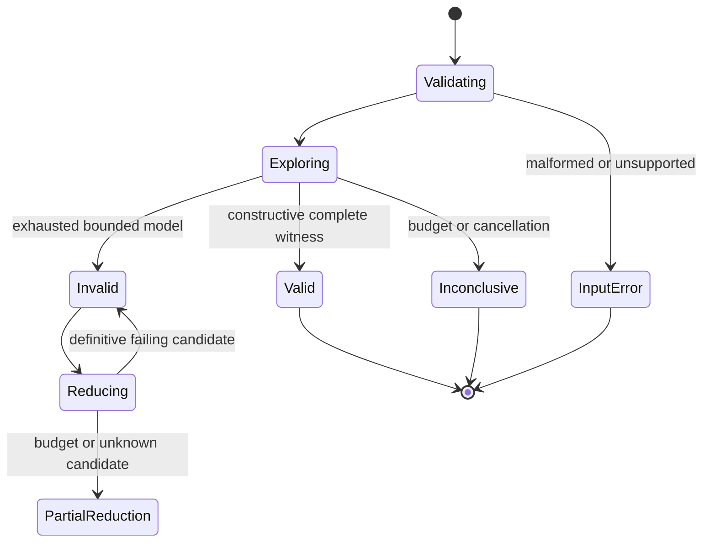
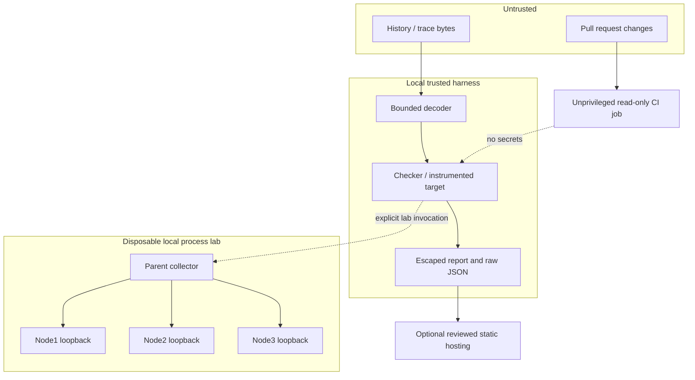

# Architecture
Status: full design contract. The source delivered initially is a tested kernel, not the whole target laboratory. See LIMITATIONS.md for the implementation boundary.

## Context and components

One Go executable owns the trusted harness. There is no database service, queue service, web backend or model provider in the core. Pure modules: history schema/checker, diagnostic reducer, event queue, fault model, entropy source, target integration, trace codec and report generator. The real-process conformance adapter is a separate explicit lab mode, not a default daemon.

## Checker and data semantics
The register specification is a small independently written transition function: write(v) changes the state to v; a completed read(v) is legal only if current state equals v. Histories record invocation and return ordinals, not unsynchronized machine clocks. Strictly earlier returns constrain later invocations. Ties are overlapping. Each operation appears once by ID; retries of a logical request must be reconciled at collection, not guessed by the oracle.

Use depth-first search over `(linearized_operations_bitset, register_value)` with a failed-state memo table and precomputed predecessor masks. Eligible operations have all required completed predecessors already placed. All completed operations must be placed; a pending write may be included or omitted; a pending read can be omitted without observed state change. Stop as VALID only with a constructive witness. The finite bounded model is complete if search exhausts without reaching the state budget; budget or cancellation yields INCONCLUSIVE. This is neither a proof of the target nor a multi-key transactional checker.

## Deterministic execution boundary
The scheduler has one owner and a stable `(virtual_time, insertion_sequence)` heap. No goroutine races, wall time, map iteration order or unrecorded entropy may influence a logical simulation trace. Simulation iteration over node IDs, links, state maps and failures uses explicit sorted order. Event payloads are copied at admission. Logical clocks are unsigned integers with overflow checks; work and queue limits are explicit.

Use a versioned per-node PRNG (SplitMix64-v1 with published golden vectors) for target election randomness and a separate stream for fault/workload choices. Every choice records stream ID, sequence, bound and value; replay validates rather than resamples it. PRNG is for tests, NEVER keys/tokens.

**Important researched integration issue:** etcd/raft v3.7.0 uses a private global random source for election timeout choices; the inspected Config has no injection hook. Merely seeding the harness does not control that choice. The chosen solution is a minimal audited source patch adding `Config.ElectionRandom func(n int) int`, stored per raft instance and used only at election-timeout selection. Nil retains upstream behavior. The adapter supplies a record/replay decorator. Keep the upstream version, source digest, patch and test diff in the dependency record; label the target **instrumented etcd/raft**, not unmodified etcd. If a later upstream release offers an equivalent supported hook, prefer it with an ADR/deviation and conformance tests. Do not override process-wide crypto/rand or call unsafe/linkname.

The core distribution must contain the small patch and a reproducible fetch/apply/check script, not an undocumented fork. Fetch only the locked upstream module; preserve its license/NOTICE. Validate callback outputs in range. Compile both simulation and real-process adapters from the same instrumented target code. Upstream tests plus repeat-trace experiments are required before a determinism claim.

## Target and persistence contract
Fixed IDs1,2,3; fixed membership; integer register initially0. etcd/raft owns consensus; FaultBraid owns the integration boundary. Defaults: election tick10, heartbeat tick1, PreVote=true, CheckQuorum=true, ReadOnlySafe, DisableProposalForwarding=true, max message64KiB, max uncommitted1MiB, max inflight64. Use synchronous Ready/Advance mode initially, not AsyncStorageWrites.

At each node transition, drain Ready in one serialized loop: encode immutable message bytes; atomically append Entries/HardState/Snapshot to the staged store; complete the modeled durable barrier; update the readable Storage view; release outbound messages; apply committed entries in order; satisfy writes only after application; satisfy ReadIndex reads only after the returned index has been applied; then Advance. This deliberately conservative order sacrifices some parallel IO to make the correctness boundary legible. Do not substitute MemoryStorage for modeled durability across restart.

The register command contains request ID and value. Replicated state includes deduplication `(request_id,payload_hash,result)`; reusing the ID with another payload is rejected. A timeout is pending/unknown and a later retry uses the same identity. Reads use unique ReadIndex contexts; no lease-only reads. Stop mutation on uncertain persistence errors; restart from a validated durable prefix. Snapshot compaction is excluded from the first target campaign to keep the core finite, but the interface must reject unsupported snapshot input rather than ignore it. The log budget terminates a run INCONCLUSIVE before unbounded growth.

## Network and failure model
Directed links can delay, drop or duplicate complete protobuf messages; partitions are pairs of directed policies. Corruption is outside Raft's non-Byzantine model: malformed frames are parser tests, not a tolerated consensus fault. Crashed nodes do not tick or consume messages. Pre-crash queued deliveries carry node incarnation and are dropped on mismatch after restart. Disk fault schedule chooses before-write, after-stage-before-flush, after-flush-before-send, after-apply-before-response. Only completed durable barriers survive. Crash/restart increments incarnation; request identities and applied state are recovered from durable data.

## Trace and reduction
Record header identity (schema, source tree digest, dependency lock/patch digest, scheduler/PRNG version, target model, initial state), scenario, ordered choices, logical events and output-history digest. Trace hashes establish consistency, not authenticity against the maintainer rewriting all files. Atomic exclusive file creation prevents overwriting original evidence.

`minimize-history` removes operation records and rechecks INVALID. It is a diagnostic projection, not an executable reproducer and not a unique root-cause explanation. `shrink-scenario` removes workload/fault actions, reruns the SAME target with the original seed/configuration, and accepts only a candidate that still violates the same requirement/variant/failure-kind fingerprint. It stores the candidate's newly generated trace and replays that trace before acceptance. Invalid causality or a missing prerequisite is a rejected candidate, not an invariant failure. Final deletion pass establishes only 1-minimality under the declared transform; budgets/unknowns clear the minimality flag. Never call the result globally smallest.

## Trust and deployment

No untrusted plugin dynamic loading. The process lab launches only the built-in node subcommand from a verified build; loopback only, no remote authentication claim. The parent owns child PIDs, temporary directories and cleanup. Process mode shares integration transitions, but sockets, kernel scheduling and actual filesystem behavior are not bitwise replayable. Its purpose is conformance and detecting model omissions, not certifying physical power loss.

## Operations and removal test
| Component | Requirement | Simpler alternative | Decision and property lost on removal |
|---|---|---|---|
| Strict schema | FR-001,SEC-002 | permissive decode | Reject ambiguity and resource bombs; removal changes interpretation |
| Bounded checker | FR-002..004 | assert final value | Concurrency needs possible legal orders; final value misses stale reads |
| Independent Porcupine tests | AC-016 | self-tests only | Detect shared fixture blind spots; not a production runtime dependency |
| Event scheduler | FR-006,REL-003 | goroutines + sleep | Deterministic ordering/replay would be lost |
| Virtual store | FR-007,REL-002 | in-memory map | Durability boundaries and crash experiments would be lost |
| Mature Raft target | FR-009 | toy counter only | Removes real integration depth and invalidates selection rationale |
| Election entropy hook | REL-003 | seed harness only | Upstream hidden entropy would invalidate reproducibility |
| Scenario reducer | FR-011 | long failing logs | Loses small executable counterexamples |
| Real process lab | FR-013 | simulation only | Loses a check against IO/model divergence |
| Offline HTML | FR-012 | JSON only | A thin inspector materially improves reviewer comprehension; no frontend framework needed |
| Microservices/cloud/DB | none | one process/files | Removed: no required property is gained |

Startup validates schema/limits/dependency identity before work. Shutdown cancels searches, waits for owned children, closes files and writes a non-success partial-run record. No background daemon, automatic network call, secret store, live API or migration service is needed. Schema changes are explicit new versions with converters retaining originals; incompatible traces fail closed. Logs are bounded and synthetic by default; metrics are run-local counts/durations, not an always-on monitoring stack.
