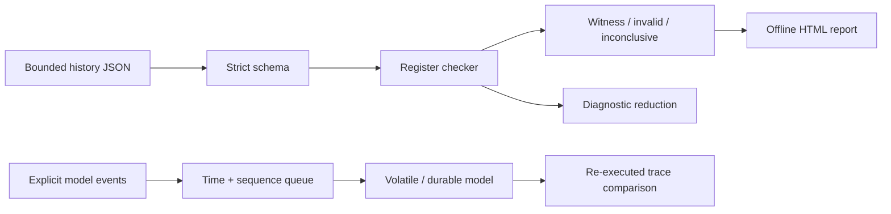

<div align="center">

# FaultBraid

### Make a failure small enough to understand.

**Bounded histories. Explicit uncertainty. Re-executed traces.**

[Quickstart](#quickstart) · [How it works](#how-it-works) · [Evidence](#verification) · [Boundaries](#what-this-is--and-is-not)

</div>

---

FaultBraid is an experimental correctness workbench for distributed-state integrations. Its **implemented local kernel** checks concurrent integer-register histories, handles uncertain operations, reduces invalid histories for diagnosis, and replays a deterministic disk model.

> **The distributed target is not implemented yet.** The three-voter Raft integration, target fault campaigns, causal scenario reducer and real-process lab are specified, not completed. `make verify-seed` and full release acceptance are deliberately separate.

## The idea

A timed-out write may still have happened. A green check can mean "a legal explanation exists" or merely "the search stopped." A recorded hash can match even when nobody re-executed the system.

FaultBraid makes those distinctions visible. The checker returns **VALID**, **INVALID**, or **INCONCLUSIVE**. A valid history includes a legal sequential witness. A replay reconstructs model state from events rather than trusting stored outputs.

| Check | Reduce | Replay |
|:--|:--|:--|
| Find a legal order respecting real-time intervals | Keep a deletion only when the smaller history is still definitively invalid | Re-execute explicit model events and compare the entire trace |
| Pending writes may be included or omitted | Diagnostic only; not a claim of causal reproduction | Stable virtual time and insertion order |

## Quickstart

Use Linux, Go, Python3.11+, Make, Git and a C compiler for race detection. The release/CI toolchain is **Go1.27.2**. The delivered seed was tested in a restricted environment on Go1.23.2; that older execution is not a supported-release endorsement.

From this source directory:

```sh
make bootstrap
make build
make verify-seed
make demo
```

No cloud service, database, root privilege or API key is needed. The demo prints a local HTML path and creates synthetic histories plus a disk-model trace under ignored `.local-runs/`.

```sh
./bin/faultbraid check -in examples/valid.json
./bin/faultbraid check -in examples/pending.json
./bin/faultbraid check -in examples/invalid.json
```

The last command deliberately returns **exit1 / INVALID**. `check` exits0 for VALID,2 for input/I/O errors and3 for INCONCLUSIVE. An exhausted search is never a passing semantic result.

## How it works



The history checker explores admissible sequential orders with a `(selected operations, register value)` failed-state cache. It only memoizes fully explored failed subtrees. Search budgets and cancellation preserve uncertainty. The independent finite oracle instead enumerates optional subsets and complete permutations.

The disk model demonstrates a narrow boundary: **write → crash loses unflushed state; write → sync → crash retains flushed state**. It is not a physical filesystem or Raft cluster.

## Verification

```sh
make test race
make fuzz mutation
make benchmark
make clean-verify       # requires reviewed, committed source
make public-audit
```

See [VERIFICATION_REPORT.md](VERIFICATION_REPORT.md) for actual commands, runtime and outcomes; [TEST_MATRIX.md](TEST_MATRIX.md) for acceptance coverage; [CLAIMS_EVIDENCE.md](CLAIMS_EVIDENCE.md) for claim-to-proof links; and [BENCHMARKS.md](BENCHMARKS.md) for measurement scope.

`make verify` is the **full project gate** and currently fails because required distributed-system work is absent. The checked-in workflows have not been run on GitHub by this package. No badge asserts otherwise.

## What this is - and is not

This is source, tests and explicit reasoning for a bounded correctness experiment. It is **not** a new consensus algorithm, production database, hostile-code sandbox, prompt-injection detector, multi-tenant service, complete formal proof or hardware power-loss certification.

The complete design uses a mature Raft core with an explicit election-entropy hook, conservative persistence ordering, quorum-safe reads, failure fingerprints and same-target real-process conformance. Read the [architecture](ARCHITECTURE.md) and [acceptance contract](ACCEPTANCE_SPEC.md) before interpreting that roadmap as delivered behavior.

## Read the code

| Area | Source / contract |
|:--|:--|
| History semantics and bounded search | `internal/history/` · [API](API_SPEC.md) |
| Deterministic model primitives | `internal/sim/` · [data ownership](DATA_MODEL.md) |
| CLI and escaped local report | `cmd/faultbraid/` · `internal/report/` |
| Locked acceptance and real CLI tests | `tests/` · [evaluation](EVALUATION.md) |
| Evidence, mutations and clean checkout | `scripts/` · `verification/` |
| Failure and trust boundaries | [Threat model](THREAT_MODEL.md) · [Security](SECURITY.md) · [Limitations](LIMITATIONS.md) |

## Contribute

Start with [CONTRIBUTING.md](CONTRIBUTING.md). Preserve the locked behavior contract, add meaningful negative tests, and keep public claims below the evidence. Original source is [MIT-licensed](LICENSE); planned dependencies retain their upstream licenses.

---

<div align="center"><sub>Reproduce the failure. Inspect the assumptions. Preserve the uncertainty.</sub></div>
