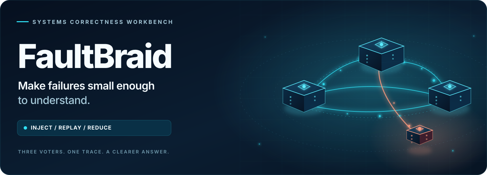

  <picture>
    <source media="(prefers-color-scheme: dark)" srcset="assets/faultbraid-hero-dark.svg">
    <source media="(prefers-color-scheme: light)" srcset="assets/faultbraid-hero-light.svg">
    
  </picture>

  
  
  
  
  

  <strong>Inject the fault. Replay the evidence. Keep only what matters.</strong> 
  A reproducible distributed-systems correctness workbench built around an 
  <strong>instrumented, fixed three-voter etcd/raft cluster</strong> and a bounded register checker.

  <a href="#quickstart">Quickstart</a> &nbsp;&middot;&nbsp;
  <a href="#the-demo">See the failure</a> &nbsp;&middot;&nbsp;
  <a href="#how-faultbraid-works">Architecture</a> &nbsp;&middot;&nbsp;
  <a href="#evidence-not-just-claims">Evidence</a> &nbsp;&middot;&nbsp;
  <a href="#honest-boundaries">Limits</a> &nbsp;&middot;&nbsp;
  <a href="#documentation">Docs</a>

---

## Why FaultBraid?

Distributed failures are hard to study when the decisive message, crash or delayed response cannot be reproduced. A passing test can hide an untested interleaving; an error can hide an operation that **actually took effect**.

**FaultBraid turns a bounded failure into something you can inspect and rerun.** It controls virtual time, network delivery, crash points and election entropy; collects operation histories; checks whether they admit a legal sequential explanation; and reduces a failing **executable scenario**, not merely a screenshot or log excerpt.

<table>
  <tr>
    <td width="25%" valign="top"><strong>01 / Inject</strong> Schedule partitions, drops, delays, duplicates and crashes against three voters.</td>
    <td width="25%" valign="top"><strong>02 / Observe</strong> Capture client intervals, pending outcomes, target events and a bounded verdict.</td>
    <td width="25%" valign="top"><strong>03 / Replay</strong> Re-execute the target with recorded entropy and reject mismatched traces.</td>
    <td width="25%" valign="top"><strong>04 / Reduce</strong> Delete scenario actions, rerun candidates and retain the smaller reproducer.</td>
  </tr>
</table>

## Quickstart

**You need:** Go **1.27.2** (pinned in [`.go-version`](.go-version)), Python 3.11+, Git, Make and GCC for race detection. Linux and Windows were exercised for the recorded release; use Linux or WSL2 for the simplest setup. Windows Make requires `sh.exe` on `PATH`.

~~~bash
git clone https://github.com/C-X1an/faultbraid.git
cd faultbraid
make bootstrap
make demo
~~~

`make bootstrap` prepares the pinned Raft module and applies the checked-in, checksum-validated entropy patch. `make demo` builds the CLI, runs **safe and deliberately unsafe** scenarios, replays the unsafe trace ten times, shrinks its executable scenario, and writes offline HTML inspectors beneath the ignored `.local-runs/` directory.

No cloud account, API key, database, hosted service or administrator privilege is required. Dependency preparation and the online vulnerability scan require network access.

> [!TIP]
> The demo prints the generated inspector paths. Open the relevant `report.html` in a browser. The inspector is static, escaped HTML: no scripts, external resources or server required.

## The demo

**A stale read, made reproducible.** The deliberately defective `unsafe-local-read` variant bypasses quorum confirmation, allowing a minority-side read to return stale state after a write has been acknowledged by a majority. This is a **purpose-built diagnostic defect, not a reported etcd/raft vulnerability**.

| Experiment | What you will observe |
|:--|:--|
| **Safe Raft scenario** | A `VALID` history for the configured test. |
| **Intentionally unsafe local read** | An `INVALID` history with inspectable operations and causal records. |
| **Trace replay** | Re-execution checks recorded choices *and* a fresh seeded run; mismatches are rejected. |
| **Scenario reduction** | Executable action deletions are accepted only when the same failure fingerprint survives rerun and replay. |

<strong>Run the scenario, replay and reduction steps manually</strong>

Every output directory below must be new. `make demo` already runs this sequence with its own owned paths; the following commands are for a separate experiment.

~~~bash
mkdir -p .local-runs
make build
./bin/faultbraid simulate -scenario examples/raft-safe.json -outdir .local-runs/safe
./bin/faultbraid simulate -scenario examples/raft-unsafe.json -outdir .local-runs/unsafe
./bin/faultbraid replay -in .local-runs/unsafe/trace.json
./bin/faultbraid shrink-scenario -trace .local-runs/unsafe/trace.json -strategy ddmin -max-checks 1000 -outdir .local-runs/reduced
./bin/faultbraid replay -in .local-runs/reduced/trace.json
~~~

On Windows PowerShell, replace `./bin/faultbraid` with `.\bin\faultbraid.exe`. Keep the **same source-identified build** for replay and reduction. A saved older release trace is historical evidence, not a valid input for a newer source identity.

### A recorded, reproducible result

The following measurements come from the identified **A6 source on Go 1.27.2 / Windows**, not a claim about all executions or the current checkout. The full inputs, command records and limitations are public in the [verification report](VERIFICATION_REPORT.md).

| **1,000 / 1,000** | **10 / 10** | **11 → 5** | **24 / 24** |
|:--:|:--:|:--:|:--:|
| Recorded finite campaign seeds accounted for as `VALID` | Selected unsafe-trace replays matched | Actions in the recorded reduced unsafe scenario | Locked criteria covered by the original separate assessment |

The 1,000-seed campaign covers **finite configured schedules**. The reducer reports **deletion one-minimality within its search domain**, not a global minimum. Saved evidence is bound to its original source; use `make demo` to create replayable traces for this checkout.

## How FaultBraid works

~~~mermaid
flowchart LR
    S["Scenario + seed"] --> V["Virtual event scheduler"]
    V --> N["Faulted network + storage"]
    N --> R["Instrumented etcd/raft: 3 voters"]
    R --> H["Client history"]
    H --> C["Bounded checker VALID / INVALID / INCONCLUSIVE"]
    R --> T["Source-bound trace"]
    T --> P["Two-pass replay"]
    T --> D["Executable scenario reducer"]
    D --> V
    C --> I["Offline HTML inspector"]
    P --> I
~~~

| Boundary | Engineering decision | Inspect |
|:--|:--|:--|
| **Consensus** | Instrumented etcd/raft v3.7.0; explicit election entropy, fixed membership and conservative `Ready` → durable-flush → send/apply ordering. | [`internal/target/`](internal/target/) · [`internal/raftadapter/`](internal/raftadapter/) |
| **Consistency** | Register histories include pending operations; exhausted search returns `INCONCLUSIVE`, never a fabricated success. | [`internal/history/`](internal/history/) · [API contract](API_SPEC.md) |
| **Reproducibility** | Stable virtual scheduler, recorded entropy, source/patch identities and two-pass target replay. | [`internal/scenario/`](internal/scenario/) · [trace codec](docs/trace-codec.md) |
| **Investigation** | Scenario-level delta debugging preserves the reproduced failure fingerprint. | [`internal/campaign/`](internal/campaign/) |
| **Native conformance** | The same target integration runs in real loopback child processes with checksummed, synced file journals. | [`internal/labreal/`](internal/labreal/) |

<strong>The three possible verdicts (and why they matter)</strong>

| Verdict | Meaning |
|:--|:--|
| `VALID` | A constructive legal sequential explanation exists. |
| `INVALID` | All admissible orders were exhausted without a legal explanation. |
| `INCONCLUSIVE` | A state budget, deadline or cancellation prevented a definitive answer. |

A timeout can leave an operation **pending**: a possibly admitted write may have taken effect even without a response. A later rejected retry does not erase that uncertainty. Command exit status is **not** universally the verdict: `replay` succeeds when execution matches an `INVALID` trace, and new inconclusive checks have their own exit code. See [command-specific semantics](API_SPEC.md).

## Evidence, not just claims

FaultBraid’s release records distinguish what actually ran from targets, historical receipts and unmeasured properties. Start with the **[verification report](VERIFICATION_REPORT.md)** and **[claims-to-evidence map](CLAIMS_EVIDENCE.md)**.

~~~bash
make verify-seed                # source checks; NOT a full-release approval
make system differential       # real target + independent checker comparisons
make campaign                  # deterministic fault campaign
make real-lab                  # native loopback child processes
make fuzz mutation             # bounded fuzzing + selected negative controls
make benchmark                 # calibrated synthetic engineering measurements
make verify                    # heavier, evidence-gated full verification
~~~

The recorded release included an independently authored assessment, finite differential checks, target mutation controls and a clean committed-checkout reproduction. **Do not infer current-head verification from historical receipts.** Look at [live workflow runs](https://github.com/C-X1an/faultbraid/actions) and the preserved [last verified pre-cleanup jobs](verification/publication/last-verified-ci.json) separately.

<strong>Native-process experiment</strong>

~~~bash
make real-lab
# Or run one profile explicitly:
./bin/faultbraid lab-real -scenario examples/raft-real.json -concurrency 4 -outdir .local-runs/native
~~~

The native lab measures the real built child executable at configured request-concurrency limits **1, 4 and 16**. It runs loopback HTTP and real process kill/restart paths; virtual link faults are not supported in this mode. There is **no native replay or physical power-loss certification**. Read [the native contract](DATA_MODEL.md) before interpreting outcomes.

## Honest boundaries

> [!IMPORTANT]
> **This is an experimental workbench, not a production database, new consensus protocol, hostile-code sandbox or complete proof of Raft correctness.** It checks finite workloads and a fixed three-voter register target. Snapshots, log compaction and dynamic membership are deliberately unsupported.

Deterministic simulation cannot prove that the OS or real network will follow the same schedule. Benchmarks are synthetic measurements with environmental limitations; no production traffic, end-user scale or physical power-loss guarantee is claimed. See the [threat model](THREAT_MODEL.md), [security policy](SECURITY.md) and [limitations](LIMITATIONS.md).

## Documentation

| **Start here** | **Go deeper** |
|:--|:--|
| [**Reviewer demo**](docs/demo/DEMO.md) — walkthrough and expected observations | [**Architecture**](ARCHITECTURE.md) — scheduling, persistence and trust boundaries |
| [**API & command contract**](API_SPEC.md) — CLI inputs, verdicts and exits | [**Data model**](DATA_MODEL.md) — trace format and native evidence |
| [**Verification**](VERIFICATION_REPORT.md) — executed results and known failures | [**Benchmarks**](BENCHMARKS.md) — methodology, distributions and raw sample links |
| [**Evidence index**](verification/README.md) — receipts and provenance | [**Evaluation**](EVALUATION.md) — test design and measurement scope |
| [**Contribute**](CONTRIBUTING.md) — review and testing conventions | [**Acceptance contract**](ACCEPTANCE_SPEC.md) — locked behavioral criteria |

Original code is [MIT licensed](LICENSE). etcd/raft, Porcupine and the patched upstream dependencies retain their own licenses and notices in [**Third-party notices**](THIRD_PARTY_NOTICES.md).

---

  <strong>A good failure report should be something you can run twice.</strong> 
  Go · instrumented Raft · deterministic faults · bounded checking · executable reduction

